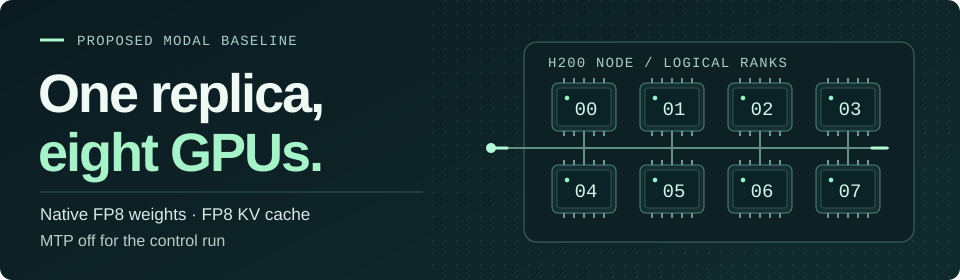
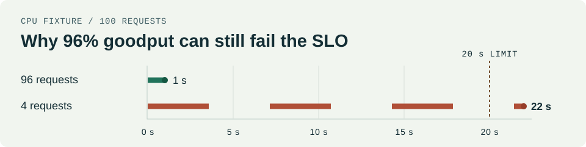
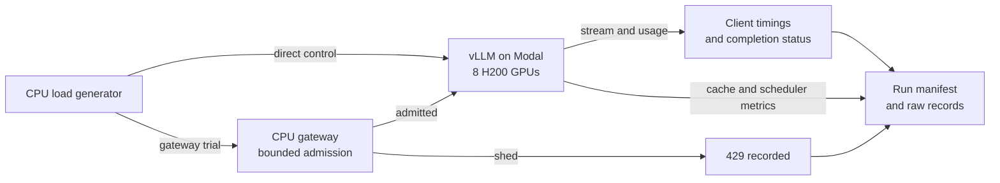

# GLM-5.2 Inference Lab

**At what request rate does speculative decoding stop paying for itself?** This project studies GLM-5.2 on Modal. The unit of comparison is the cost of delivering one million output tokens from requests that finish correctly and meet their latency targets.



**Current stage:** study design and CPU protocol checks. The first GPU run, its bill, and its performance measurements are pending. [Read the research plan](docs/research-plan.md) · [Try the CPU example](#try-the-metric-on-your-laptop) · [Explore the experiments](#experiment-sequence)

## What counts as useful work?

Imagine sending 100 requests. All begin generating within 100 ms. Ninety-six finish in one second. Four take 22 seconds. A dashboard that checks only the fraction of good requests gives the load level a pass. Anyone waiting on the slowest requests experiences a different service.



For the first workload, each prompt contains **512 tokens** and each request has a **256-token generation budget**. The proposed targets apply to this shape. We will evaluate longer prompts separately.

| To pass a load level | Target | What it captures |
| --- | ---: | --- |
| p95 time to first generated token | ≤ 2 s | Queueing and prefill as experienced by the caller |
| p99 end-to-end latency | ≤ 20 s | The slowest part of the completion distribution |
| Valid completions / offered requests | ≥ 99% | Truncation, errors, timeouts and shedding reduce this fraction |
| Good requests / offered requests | ≥ 95% | A good request completes correctly within both individual time bounds |

**Cost per million useful tokens** = attributed run cost × 1,000,000 / output tokens from good requests. A run with zero useful tokens has no finite cost per million. We will report warm serving cost alongside the full bill, including startup and idle time.

### Try the metric on your laptop

Run this example in Python 3.8 or later. It uses only the standard library and the synthetic timings above. All 100 requests in the fixture have valid terminal events.

```python
from statistics import quantiles

ttft = [0.1] * 100
end_to_end = [1.0] * 96 + [22.0] * 4
valid = [True] * 100
good = sum(ok and first <= 2 and total <= 20
           for ok, first, total in zip(valid, ttft, end_to_end))

p95_first = quantiles(ttft, n=100, method="inclusive")[94]
p99_total = quantiles(end_to_end, n=100, method="inclusive")[98]
good_fraction = good / len(valid)
passes = (p95_first <= 2 and p99_total <= 20
          and sum(valid) / len(valid) >= 0.99 and good_fraction >= 0.95)
print(f"good requests {good_fraction:.0%} | p99 {p99_total:.1f} s | passes {passes}")
```

Expected output: `good requests 96% | p99 22.0 s | passes False`. Change the four slow requests from 22 s to 19 s and run it again. The level now passes all four checks.

<details>
<summary>Try a real HTTP stream from the upstream CPU mock</summary>

With Git, Docker Compose and curl installed, run these commands in Bash, WSL or Git Bash. This checks out the reference demo in a separate directory. The mock emits synthetic tokens and needs no GPU or Modal account.

```bash
git clone https://github.com/VizuaraAI/capstone-serve-glm-5-2.git glm-reference
cd glm-reference
git checkout --detach f90a208b1ee23ab1f0aea28ef6cff9cdab99e615
docker compose up --build --detach --wait gateway
curl --no-buffer http://localhost:8080/v1/chat/completions \
  -H 'Authorization: Bearer sk-local' -H 'Content-Type: application/json' \
  -d '{"model":"mock-engine","messages":[{"role":"user","content":"Hello"}],"max_tokens":4,"stream":true}'
docker compose down
```

Look for four text deltas (`tok0` through `tok3`), a finish reason, and a final `[DONE]` event. The local demo key comes from the reference Compose file.

</details>

## Serving architecture

The first benchmark goes directly to one warm engine. The second replays the same seeded arrivals through a CPU gateway, keeping the model, GPU count and engine configuration fixed. That pair measures the latency and overload behavior introduced by admission control.



| Bring-up step | Implementation detail | Evidence to retain |
| --- | --- | --- |
| Prepare the weights | Pin the FP8 checkpoint and tokenizer revision. Stage the shards on a Modal Volume before timing a warm start. | Revision, shard bytes, cold fetch and cached load duration |
| Start one engine | Pin the vLLM image by digest. Request `H200:8`, set tensor parallelism to 8 and begin with an 8,192-token context cap. Set a run deadline, spend limit and idle scale-down. | Effective flags, image digest, device inventory, memory after load and a valid streamed decode |
| Measure the engine | Use an independent CPU client. Begin at concurrency one, find the capacity boundary, then replay fixed-rate or seeded Poisson arrivals around it. | Per-request timestamps, verified token counts, terminal events, raw engine counters and billed duration |
| Add the gateway | Repeat on the same warm replica. Track time in queue, rejection rate and recovery following a 3× arrival burst. | Paired results, admitted p99 and goodput across **all** arrivals |

Read the upstream recipe for the exact flags supported by your engine version. Model fit and initial memory headroom are checks for the first Modal run. [vLLM serving recipe](https://recipes.vllm.ai/zai-org/GLM-5.2) · [Official FP8 checkpoint](https://huggingface.co/zai-org/GLM-5.2-FP8) · [Modal GPU setup](https://modal.com/docs/guide/gpu)

## Experiment sequence

| Experiment | Change one factor | Decision the result supports |
| --- | --- | --- |
| Multi-token prediction (MTP) | Off, then 1, 3 or 5 draft tokens at each offered load | At which loads does accepting several tokens per verification step repay the drafting cost? |
| Prefill scheduling | Chunked-prefill budget with a fixed mix of short chats and 4k-token prompts | How much long-prompt work can share a batch before short-request tails miss their target? |
| Prefix reuse | Cache off/on at 0%, 50% and 90% shared-prefix traffic | Which workload justifies reserving cache capacity? |
| KV cache precision | FP8 vs a supported higher-precision cache, with identical weights | What capacity gain survives a retrieval-quality check? |
| Expert weight precision | Native FP8 vs expert NVFP4 on the same B200 hardware | Does the memory or cost gain justify the measured quality change? |

For each comparison, pair seeds and prompts, randomize run order and record failures. Keep cold starts separate from warm runs. Report uncertainty around the load where a change begins to help or hurt. The plan specifies the repetition, tail-sampling and quality criteria. [Full experiment protocol](docs/research-plan.md#measurement-contract)

## Starting point and reproducibility

The initial code inspection used the MIT-licensed **Vizuara AI Labs** serving capstone. Its reference suite passed 16 CPU tests. Two additional CPU fixtures exposed a truncated stream counted as successful and a p99 failure admitted by the ceiling calculation. Those findings define the first implementation milestone. The capstone supplies the reference gateway and mock engine. This repository tracks the Modal work, measurement fixes and experiments as they land. [Upstream capstone and local demo](https://github.com/VizuaraAI/capstone-serve-glm-5-2) · [License](LICENSE)

Each experiment PR should carry a command that reproduces the result, the Git and model revisions, the workload hash, and a link to checksummed raw records. A reader should be able to trace every published number back to a run and its bill.
